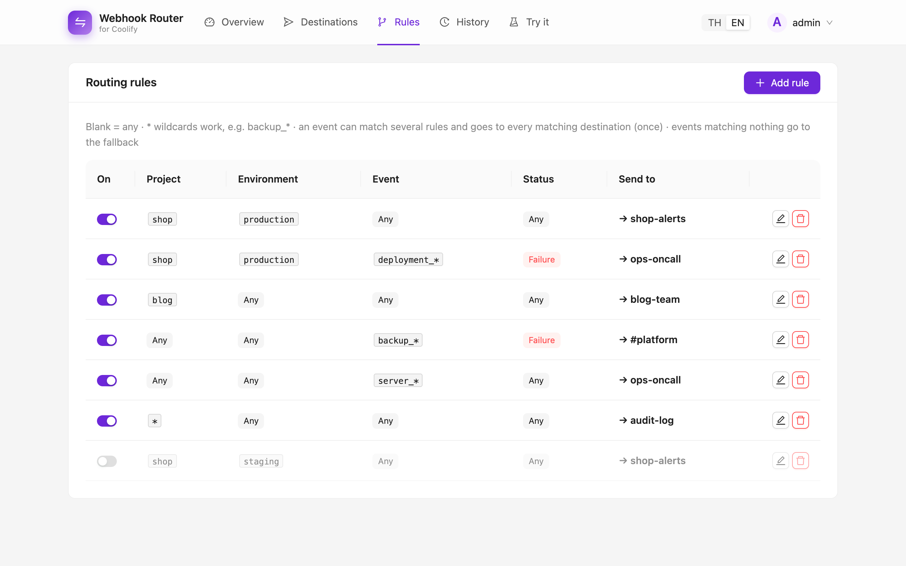
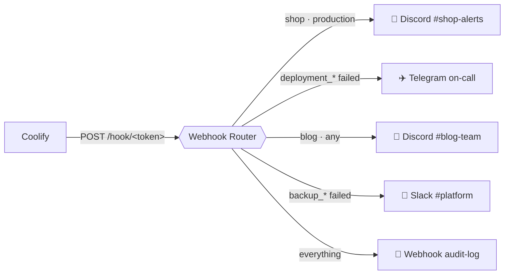
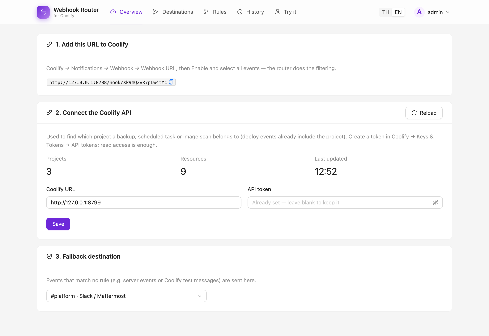
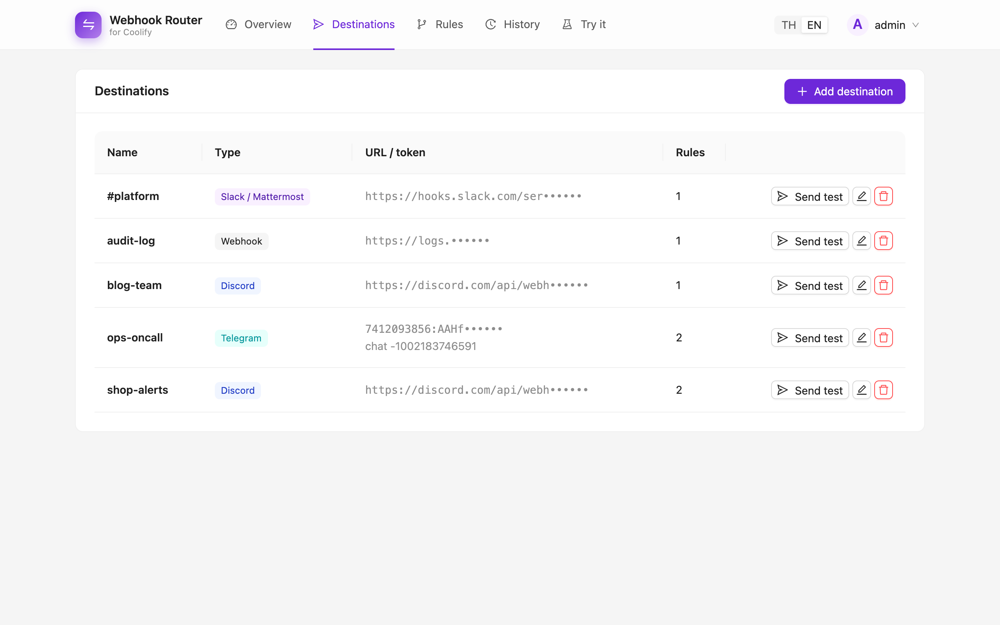
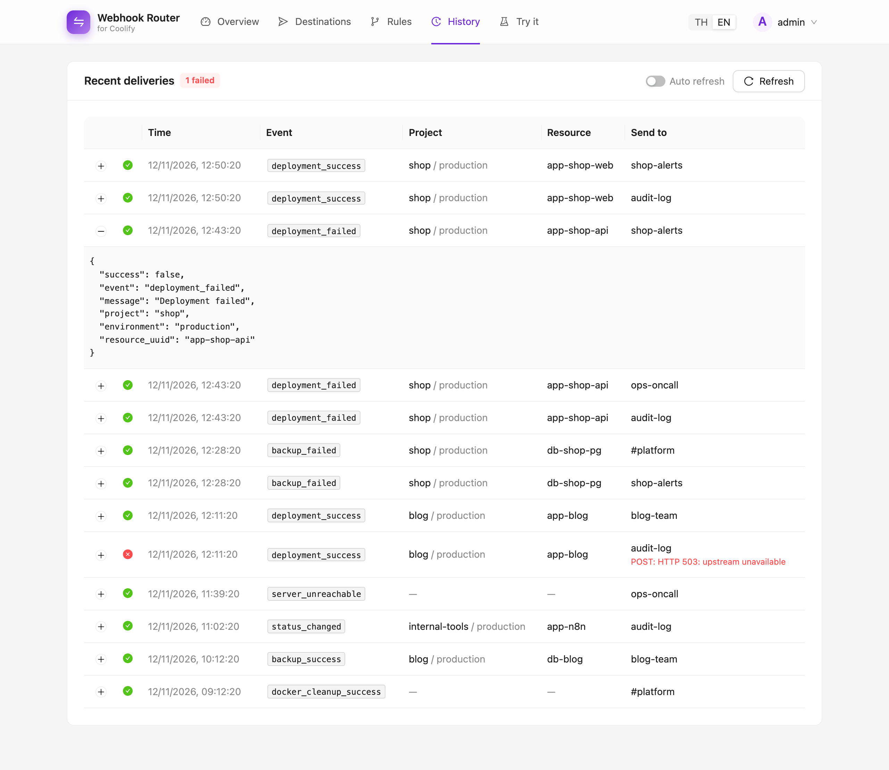
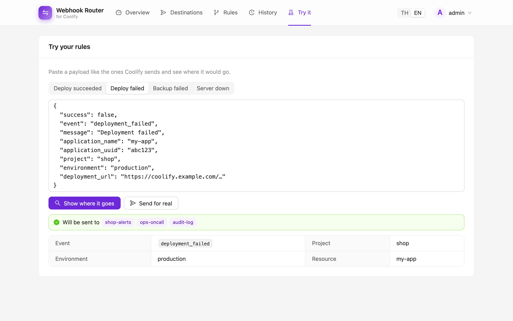
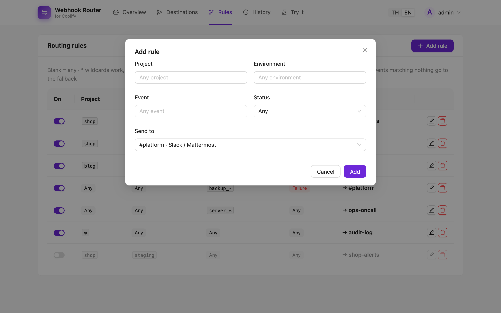
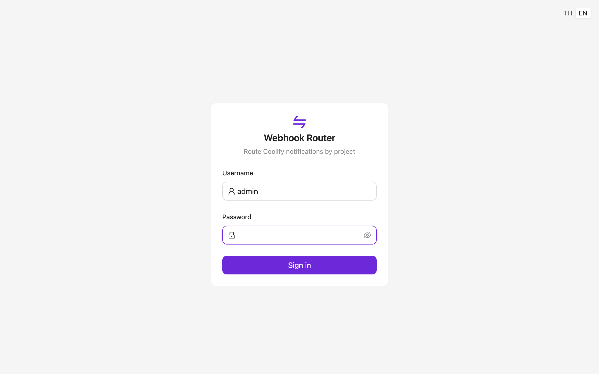

<div align="center">

# ⇄ Coolify Webhook Router

**One Coolify webhook in. The right channel out.**

Coolify sends all notifications for a team to a single webhook URL.
This small service sits in between and routes each event to Discord, Slack, Telegram or any webhook,
based on **project, environment, event and status**. You set it up in a web UI, so there's nothing to redeploy.

[](go.mod)
[](web/package.json)
[](https://ant.design)
[](store.go)
[](Dockerfile)
[](LICENSE)

**English** · [ภาษาไทย](README.th.md)

<picture>
  <source media="(prefers-color-scheme: dark)" srcset="docs/screenshots/rules-dark.png">
  
</picture>

</div>

---

## Why

You run many projects on one Coolify instance. Coolify sends **every** deploy, backup and server alert to **one** URL,
so `#shop` gets blog failures and on-call gets every successful deploy.



## Features

- 🎯 **Rules by project / environment / event / status.** Supports `*` wildcards such as `backup_*`, and leaving a field blank means "any". If an event matches several rules it goes to every matching destination, once each.
- 🔎 **Finds the project even when Coolify leaves it out.** Backup, scheduled-task and image events only include a UUID; the router looks it up through the Coolify API.
- 📮 **Discord, Slack / Mattermost, Telegram and plain webhooks.** Messages are formatted for each platform, with color-coded Discord embeds.
- 🛟 **Fallback destination** for events that match no rule, so nothing is lost silently.
- 🧪 **"Try it" page.** Paste a payload and see where it would go before it happens for real.
- 📜 **Delivery history** with the full payload and error for every send. Failed sends are retried.
- ⚡ **Changes apply instantly.** Everything lives in SQLite, so you never redeploy to change routing.
- 🔐 **Secure by default:**
  - Session login with per-IP lockout.
  - Secret webhook token in the URL.
  - Destination URLs and tokens are never sent back to the browser.
- 🌗 **Light and dark mode, English and Thai.**
- 📦 **One ~16 MB static binary.** The UI is embedded with `go:embed`, and there is no CGO.

## Screenshots

| Overview | Destinations |
|---|---|
| <picture><source media="(prefers-color-scheme: dark)" srcset="docs/screenshots/overview-dark.png"></picture> | <picture><source media="(prefers-color-scheme: dark)" srcset="docs/screenshots/destinations-dark.png"></picture> |
| **Delivery history** | **Try your rules** |
| <picture><source media="(prefers-color-scheme: dark)" srcset="docs/screenshots/history-dark.png"></picture> | <picture><source media="(prefers-color-scheme: dark)" srcset="docs/screenshots/simulate-dark.png"></picture> |
| **Add a rule** | **Sign in** |
| <picture><source media="(prefers-color-scheme: dark)" srcset="docs/screenshots/rule-modal-dark.png"></picture> |  |

## Deploy on Coolify

1. **Create the app.** In Coolify, add a new **Application** from this repository. Set the build pack to **Dockerfile** and the port to `8080`.
2. **Add persistent storage.** Mount a volume at `/data`. This holds the SQLite database with your settings and history.
3. **Set the environment variables:**

   | Variable | Required | Description |
   |---|:---:|---|
   | `ADMIN_PASSWORD` | ✔ | Password for the web UI. Changing it signs out every session. |
   | `ADMIN_USER` | | Username for the web UI. Default `admin`. |
   | `HOOK_TOKEN` | | Secret token in the webhook URL. If you leave it out, one is generated and shown in the UI. |
   | `COOLIFY_URL` / `COOLIFY_API_TOKEN` | | Initial Coolify API connection. You can also set it in the UI. |
   | `LISTEN_ADDR` / `DB_PATH` | | Defaults are `:8080` and `data/router.db`. |

4. **Add a domain and sign in.** Give the app a domain, for example `hooks.example.com`, then open it and sign in.
5. **Follow the Overview page:**
   - Copy the webhook URL into **Coolify → Notifications → Webhook**.
   - Enable it and select **all events**. The router does the filtering.

> [!NOTE]
> Coolify refuses webhook URLs that point to private IPs or localhost. Use the router's public domain, or add it under **Settings → Advanced → Allowed internal targets**.

### Docker

```sh
docker build -t coolify-webhook-router .
docker run -d -p 8080:8080 -v router-data:/data -e ADMIN_PASSWORD=change-me coolify-webhook-router
```

## How events are matched to projects

| Event | Project comes from |
|---|---|
| `deployment_*`, `status_changed`, `restart_limit_reached` | `project` / `environment` fields in the payload |
| `backup_*`, `task_*`, `image_*` | Resource UUID, looked up through the Coolify API (needs a read-only API token) |
| `server_*`, `docker_cleanup_*`, `container_restarted`, `test` | No project. Match these by event name, or let them go to the fallback. |

Coolify API data is cached for 5 minutes. An unknown UUID triggers a refresh, at most once every 30 seconds.

## Security

- **Web UI**
  - Signed session cookie: `HttpOnly`, `SameSite=Strict`, and `Secure` over HTTPS. Sessions last 7 days.
  - 5 wrong passwords from one IP locks that IP out for 5 minutes.
- **Webhook endpoint**
  - Coolify doesn't sign its requests, so the endpoint is protected by a random token in the URL, compared in constant time.
  - A wrong token returns `404`.
- **Secrets**
  - Destination URLs and bot tokens are masked in the API. Leaving the field blank when editing keeps the stored value.
  - Delivery errors never include the destination URL.

## Development

The backend is Go (`net/http` and pure-Go SQLite). The UI is React, Ant Design and Vite, in [`web/`](web), built into the binary.

```sh
# Run it the way production does
cd web && npm install && npm run build && cd ..
ADMIN_PASSWORD=dev LISTEN_ADDR=:8787 go run .     # → http://localhost:8787

# UI with hot reload (keep the Go server above running)
cd web && npm run dev                              # → http://localhost:5173

go test ./...
```

```
├── main.go        config, startup, workers
├── api.go         HTTP routes: /hook, /api/*, SPA
├── router.go      event parsing, rule matching, delivery queue
├── resolver.go    UUID → project lookup through the Coolify API
├── senders.go     Discord / Slack / Telegram / webhook formatting
├── store.go       SQLite schema and queries
├── auth.go        sessions and login lockout
├── i18n.go        Thai and English server messages
└── web/           React + Ant Design UI
```

## License

[MIT](LICENSE)
