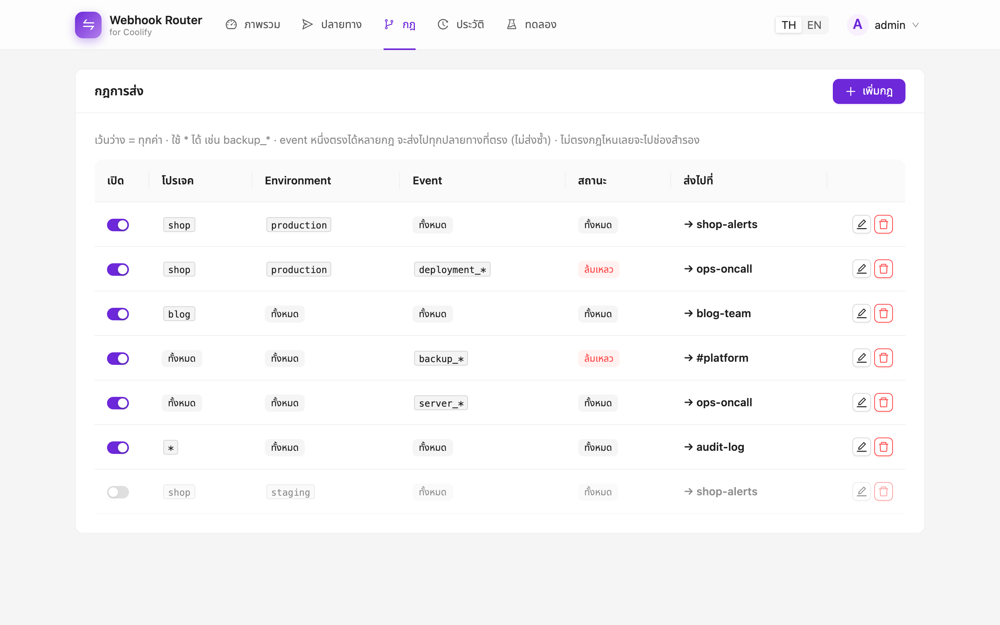
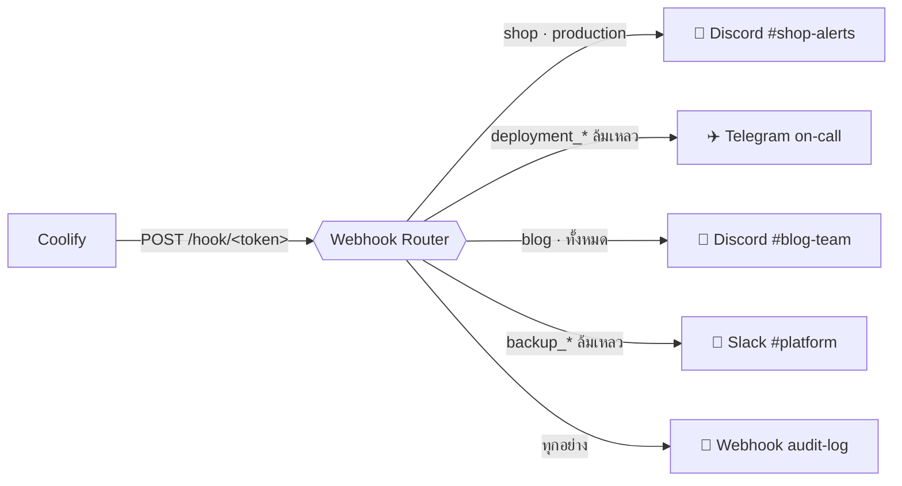
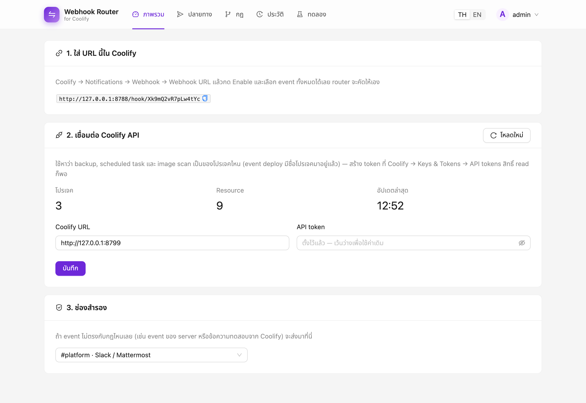
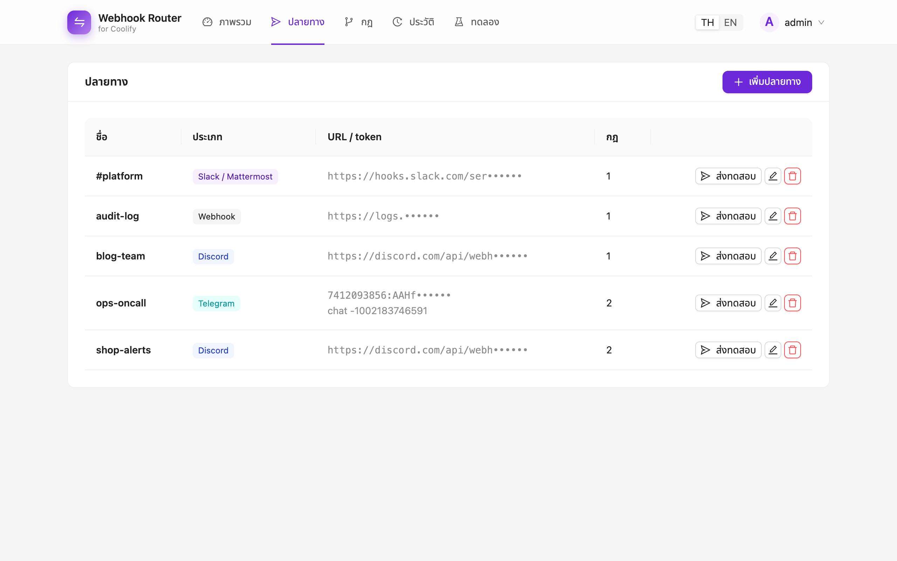
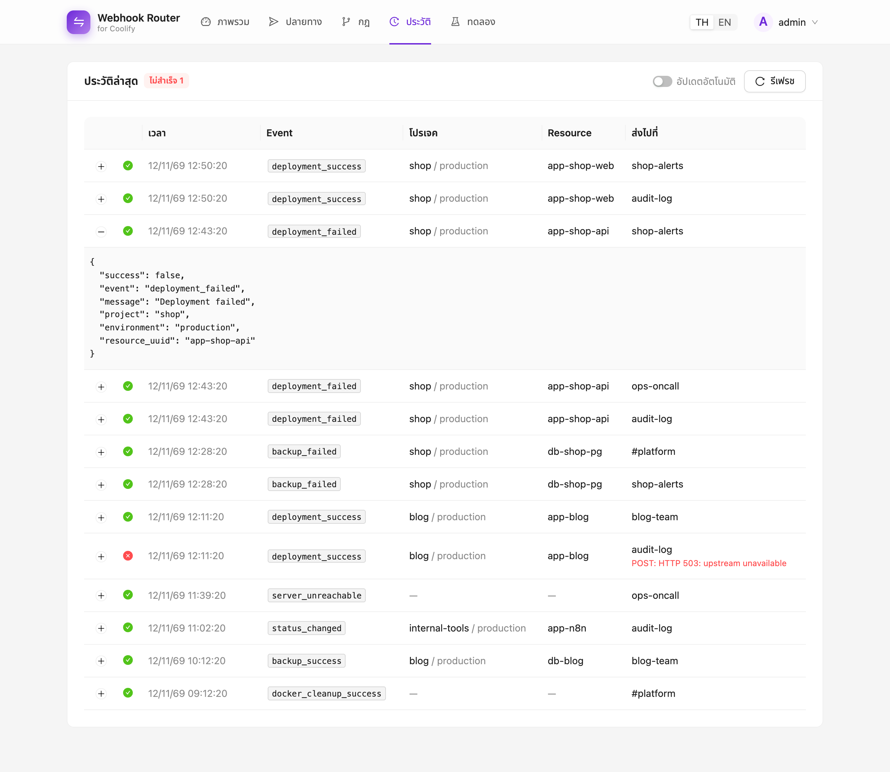
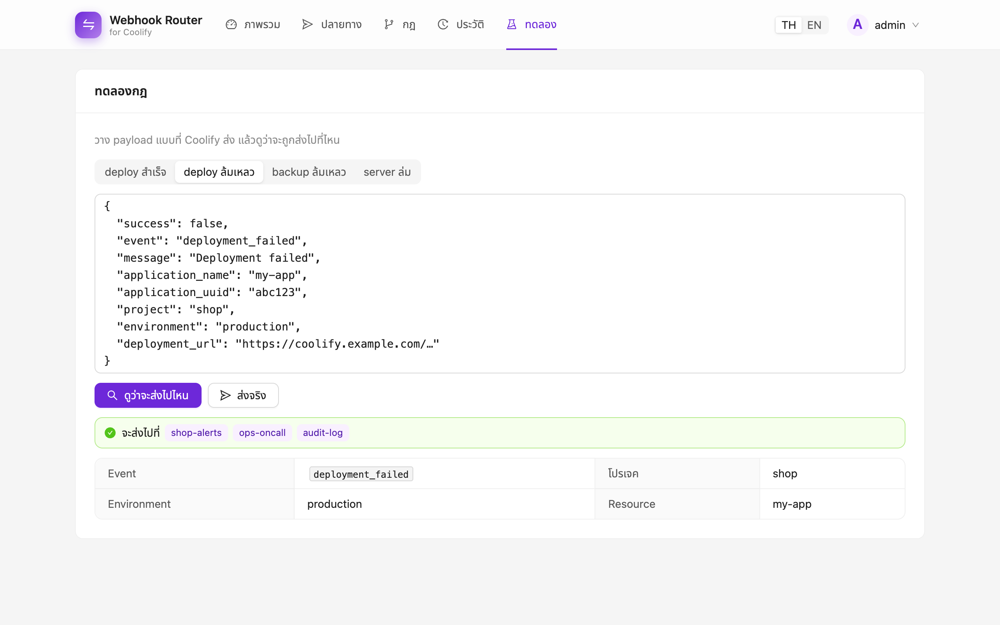
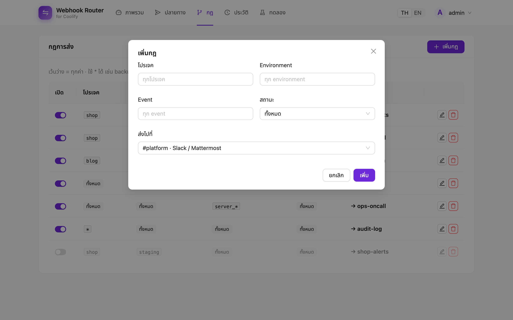
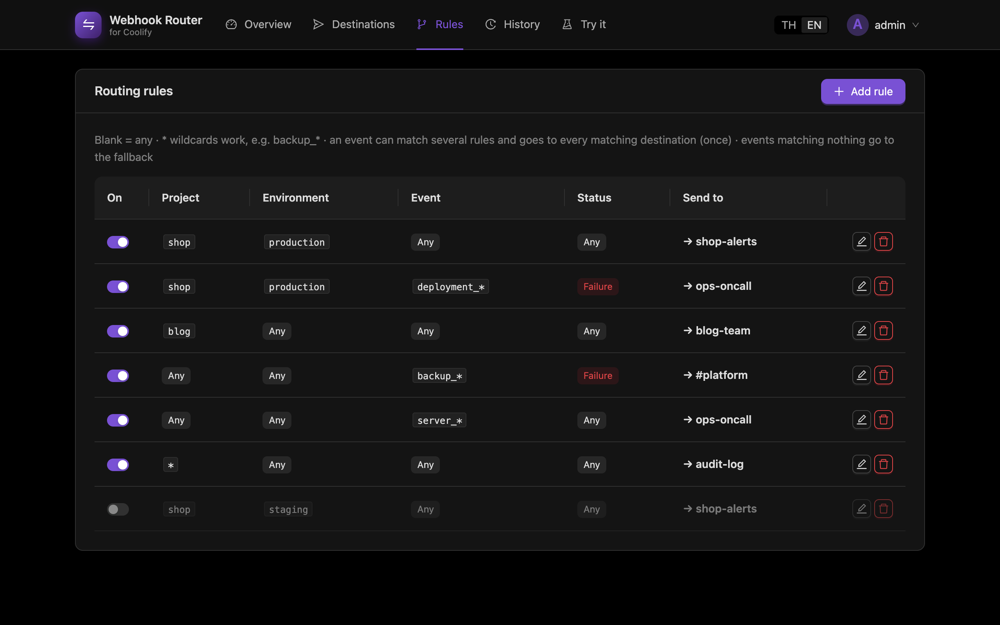

<div align="center">

# ⇄ Coolify Webhook Router

**รับ webhook จาก Coolify ช่องเดียว แล้วแยกส่งไปให้ถูกช่อง**

Coolify ส่งการแจ้งเตือนของทั้ง team ไปที่ webhook URL ได้แค่ URL เดียว
service นี้จะคั่นอยู่ตรงกลาง แล้วแยกแต่ละ event ไปที่ Discord, Slack, Telegram หรือ webhook อื่น
ตาม **โปรเจค, environment, event และสถานะ** ตั้งค่าทั้งหมดผ่านหน้าเว็บ ไม่ต้อง redeploy

[](go.mod)
[](web/package.json)
[](https://ant.design)
[](store.go)
[](Dockerfile)
[](LICENSE)

[English](README.md) · **ภาษาไทย**



</div>

---

## ทำไมต้องมี

ถ้ารันหลายโปรเจคบน Coolify ตัวเดียว ทุก deploy, backup และการแจ้งเตือนของ server จะไปรวมที่ URL **เดียว**
ผลคือห้อง `#shop` ได้แจ้งเตือนของ blog ไปด้วย และทีม on-call ก็โดนแจ้งทุกครั้งที่ deploy สำเร็จ



## ความสามารถ

- 🎯 **กฎตามโปรเจค / environment / event / สถานะ:**
  - ใช้ `*` ได้ เช่น `backup_*`
  - ช่องที่เว้นว่างหมายถึง "ทั้งหมด"
  - ถ้า event ตรงหลายกฎ จะส่งไปทุกปลายทางที่ตรง ที่ละครั้ง ไม่ส่งซ้ำ
- 🔎 **หาโปรเจคเจอแม้ Coolify ไม่ได้ส่งมา:** event ของ backup, scheduled task และ image scan มีแค่ UUID ระบบจะไปถาม Coolify API ให้
- 📮 **ส่งได้ทั้ง Discord, Slack / Mattermost, Telegram และ webhook ธรรมดา:** จัดรูปแบบข้อความให้เหมาะกับแต่ละที่ ฝั่ง Discord เป็น embed แยกสีตามผลลัพธ์
- 🛟 **ช่องสำรอง:** รับ event ที่ไม่ตรงกฎไหนเลย จะได้ไม่มีอะไรหายเงียบ ๆ
- 🧪 **หน้าทดลอง:** วาง payload แล้วดูได้เลยว่าจะส่งไปที่ไหน ก่อนเกิดขึ้นจริง
- 📜 **ประวัติการส่ง:** เห็น payload และ error ของทุกครั้งที่ส่ง ถ้าส่งไม่สำเร็จระบบจะลองใหม่ให้
- ⚡ **แก้แล้วมีผลทันที:** ค่าตั้งทั้งหมดอยู่ใน SQLite ไม่ต้อง redeploy
- 🔐 **ปลอดภัยตั้งแต่ต้น:**
  - login ด้วย session และล็อก IP ที่ใส่รหัสผิดบ่อย
  - webhook URL มี token ลับ
  - ไม่ส่ง URL หรือ token ของปลายทางกลับไปที่เบราว์เซอร์
- 🌗 **มีโหมดสว่างและมืด สลับภาษาไทยกับอังกฤษได้**
- 📦 **ไบนารีไฟล์เดียว ขนาดประมาณ 16 MB:** หน้าเว็บฝังอยู่ในไบนารี และไม่ต้องใช้ CGO

## ภาพหน้าจอ

| ภาพรวม | ปลายทาง |
|---|---|
|  |  |
| **ประวัติการส่ง** | **ทดลองกฎ** |
|  |  |
| **เพิ่มกฎ** | **โหมดมืด** |
|  |  |

## Deploy บน Coolify

1. **สร้างแอป:** ใน Coolify สร้าง **Application** ใหม่จาก repo นี้ ตั้ง Build pack เป็น **Dockerfile** และ port เป็น `8080`
2. **เพิ่มที่เก็บข้อมูลถาวร:** mount volume ไปที่ `/data` ที่นี่เก็บฐานข้อมูล SQLite ทั้งค่าตั้งและประวัติ
3. **ตั้ง Environment variables:**

   | ตัวแปร | จำเป็น | ความหมาย |
   |---|:---:|---|
   | `ADMIN_PASSWORD` | ✔ | รหัสผ่านเข้าหน้าเว็บ เปลี่ยนรหัสแล้วทุก session จะถูกออกจากระบบ |
   | `ADMIN_USER` | | ชื่อผู้ใช้หน้าเว็บ ค่าเริ่มต้นคือ `admin` |
   | `HOOK_TOKEN` | | token ลับใน webhook URL ถ้าไม่ใส่ ระบบจะสุ่มให้และแสดงในหน้าเว็บ |
   | `COOLIFY_URL` / `COOLIFY_API_TOKEN` | | ค่าเริ่มต้นของการเชื่อม Coolify API ตั้งในหน้าเว็บแทนก็ได้ |
   | `LISTEN_ADDR` / `DB_PATH` | | ค่าเริ่มต้นคือ `:8080` และ `data/router.db` |

4. **ผูกโดเมนแล้วเข้าสู่ระบบ:** ผูกโดเมนให้แอป เช่น `hooks.example.com` แล้วเปิดหน้าเว็บและเข้าสู่ระบบ
5. **ทำตามหน้า "ภาพรวม":**
   - คัดลอก webhook URL ไปใส่ที่ **Coolify → Notifications → Webhook**
   - กด Enable และเลือก **ทุก event** ปล่อยให้ router เป็นคนกรอง

> [!NOTE]
> Coolify ไม่ยอมส่งไปที่ URL ที่เป็น IP ภายในหรือ localhost ให้ใช้โดเมนสาธารณะของ router หรือเพิ่มไว้ที่ **Settings → Advanced → Allowed internal targets**

### Docker

```sh
docker build -t coolify-webhook-router .
docker run -d -p 8080:8080 -v router-data:/data -e ADMIN_PASSWORD=change-me coolify-webhook-router
```

## ระบบรู้ได้ยังไงว่า event เป็นของโปรเจคไหน

| Event | หาโปรเจคจาก |
|---|---|
| `deployment_*`, `status_changed`, `restart_limit_reached` | field `project` / `environment` ใน payload |
| `backup_*`, `task_*`, `image_*` | UUID ของ resource โดยถาม Coolify API (ต้องมี API token สิทธิ์ read) |
| `server_*`, `docker_cleanup_*`, `container_restarted`, `test` | ไม่ได้ผูกกับโปรเจค ให้ตั้งกฎตามชื่อ event หรือปล่อยไปที่ช่องสำรอง |

ข้อมูลจาก Coolify API เก็บแคชไว้ 5 นาที ถ้าเจอ UUID ที่ไม่รู้จักจะโหลดใหม่ทันที แต่ไม่เกิน 1 ครั้งทุก 30 วินาที

## ความปลอดภัย

- **หน้าเว็บ**
  - ใช้ session cookie ที่เซ็นชื่อไว้ เป็น `HttpOnly` และ `SameSite=Strict` และเป็น `Secure` เมื่อใช้ HTTPS session มีอายุ 7 วัน
  - ใส่รหัสผิด 5 ครั้งจาก IP เดียวกัน IP นั้นจะถูกล็อก 5 นาที
- **Webhook**
  - Coolify ไม่ได้เซ็นชื่อ request จึงป้องกันด้วย token สุ่มใน URL และเทียบแบบ constant-time
  - ถ้า token ผิดจะได้ `404`
- **ข้อมูลลับ**
  - URL และ bot token ของปลายทางจะถูกปิดบังใน API ตอนแก้ไขถ้าเว้นช่องว่างไว้ ระบบจะใช้ค่าเดิม
  - ข้อความ error ในประวัติไม่มี URL ของปลายทาง

## พัฒนา

Backend เป็น Go (`net/http` กับ SQLite ที่เขียนด้วย Go ล้วน) หน้าเว็บเป็น React, Ant Design และ Vite อยู่ในโฟลเดอร์ [`web/`](web) แล้ว build ฝังเข้าไบนารี

```sh
# รันแบบเดียวกับ production
cd web && npm install && npm run build && cd ..
ADMIN_PASSWORD=dev LISTEN_ADDR=:8787 go run .     # → http://localhost:8787

# แก้หน้าเว็บแบบ hot reload (เปิด Go server ด้านบนค้างไว้)
cd web && npm run dev                              # → http://localhost:5173

go test ./...
```

## License

[MIT](LICENSE)
